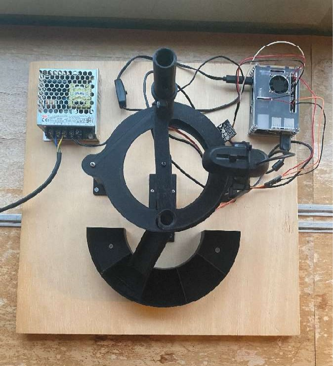

# Colour Sorting Machine
 
A machine that sorts small objects (Skittles) by colour using **computer vision**. A webcam captures each piece, a **Raspberry Pi 3** identifies its colour with **Python and OpenCV**, and two **servomotors** guide it to the correct compartment.
 
Final project (*Prova de Aptidão Profissional*) of the upper-secondary programme in Electronics and Telecommunications (EQF Level 4) at Colégio Internato dos Carvalhos, Portugal, 2023/2024. **Grade: 18/20.**
 

 
## How it works
 
1. A piece is placed in the machine and positioned in front of the webcam.
2. The Raspberry Pi captures the image and uses OpenCV to identify the piece's colour.
3. Based on the colour, the servomotors move the 3D-printed guides so that the piece falls into the matching compartment.
Most colour sorters at this level use a simple colour sensor. This project uses a **camera and image processing** instead, an approach the project's supervisors had not yet seen in final projects at this level. The idea came from the internship at Bosch Security Systems, where camera-based tests are used to inspect printed circuit boards.
 
## Hardware
 
| Component | Role |
|---|---|
| Raspberry Pi 3 (with shield) | Controls the whole system and runs the image processing |
| Logitech C270 webcam | Captures the image of each piece |
| MG996R servomotor (270°) | Moves the pieces through the machine |
| SG90 servomotor (180°) | Guides the pieces to the right compartment |
| 5 V / 10 A switching power supply | Powers the Raspberry Pi, the camera and the servos |
| 3D-printed parts on a wooden base | Machine structure |
 
Total cost of the final components: about €96.
 
## Software
 
- **Python**, developed in the Thonny IDE
- **OpenCV** for image capture and colour detection
- **RPi.GPIO** for PWM control of the servomotors
- **Raspberry Pi OS (64-bit)**
## Main challenges and solutions
 
| Problem | Solution |
|---|---|
| An Arduino could not handle a webcam or image processing, and the ESP32-CAM examples relied on an external web server | Switched to a Raspberry Pi 3, a full computer able to run Python and OpenCV |
| OpenCV would not install on the recommended 32-bit Raspberry Pi OS | Installed the 64-bit version of the operating system |
| The servomotors jittered when controlled with `gpiozero` | Rewrote the control code using the `RPi.GPIO` library |
| After merging the camera and servo code, the camera froze | Found that `time.sleep()` blocked communication with the camera and replaced it with non-blocking timing based on `time.time()` |
| The Raspberry Pi's original charger could not power the servos and the camera | Added a 5 V / 10 A switching power supply |
 
## Possible improvements
 
### Hardware and features
- **LCD display** showing how many pieces of each colour have been sorted since the program started. In an industrial setting, this would count the pieces without needing an operator.
- **Mobile app via Bluetooth** (e.g. an HC-06 module) to start and stop the machine, show and reset the piece counter, and change which colour goes to each compartment.
- **External power for the servomotors.** Powering the servos and the webcam through the Raspberry Pi overloads the board and raises its temperature, which may reduce its performance and lifespan. Only the webcam should be powered by the Raspberry Pi.
### Software
- **More robust colour detection:** average the colour over a small region instead of reading a single pixel, making detection less sensitive to lighting and noise.
- **Error handling:** check that each frame is read successfully from the camera, so the program does not crash if the webcam disconnects.
- **Clean shutdown:** stop the PWM signals and call `GPIO.cleanup()` when the program exits.
- **Simpler control logic:** start the second servo only once, and replace the separate timer variables with a list of timed steps (a simple state machine) to make the code easier to read and change.
## Applications
 
Sorting sweets has no commercial use, but the same principle is widely used in industry, for example to classify components by colour, separate materials in recycling plants, or inspect products on production lines.
 
## Repository contents
 
- `report/` – full project report (in Portuguese)
- `images/` – photos of the machine
- `src/colour_sorter.py` – Python source code
## Credits
 
- Developed by Afonso Vilas.
- Supervised by teachers at Colégio Internato dos Carvalhos.
- The 3D model of the machine's structure was adapted from [this design on Thingiverse](https://www.thingiverse.com/thing:4355784).
 
